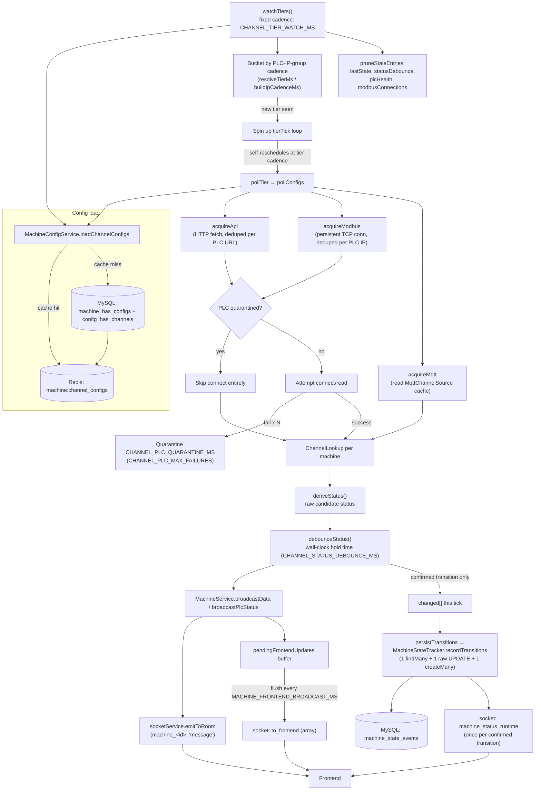
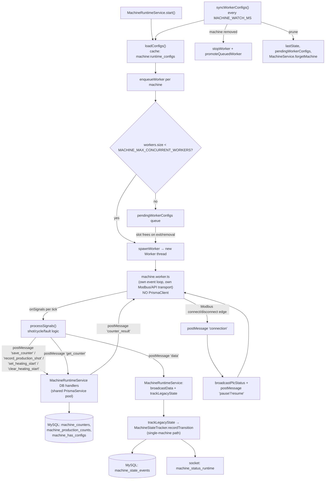
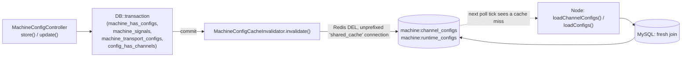

# Machine Module — Scale/Performance Fixes, This Session (2026-07-09)

Implements 12 of the 13 findings in [`SCALE_AND_PERFORMANCE.md`](SCALE_AND_PERFORMANCE.md) (#13, archival/retention for `machine_state_events`, deferred — needs a schema migration + a retention-policy decision, out of scope for a code-only session). Touches `node-server/src/module/machine/` and, for #10, `Backend/` (Laravel). Not yet committed as of this writing.

See [`CONTEXT.md`](CONTEXT.md) for the module's baseline architecture and [`CHANGES_LAST_5_DAYS.md`](CHANGES_LAST_5_DAYS.md) for how it got there before this session.

---

## Summary table

| # | Finding | Fix | Files |
|---|---|---|---|
| 2 | `to_frontend` unscoped broadcast, one emit per machine per tick | Buffered, one array-emit per `MACHINE_FRONTEND_BROADCAST_MS` (default 1s) | `machine.service.ts` |
| 8 | Unconditional per-tick success logging | Gated behind `CHANNEL_POLL_DEBUG_LOG` (default off); failures still always log | `channel-mapping.service.ts`, `mqtt-channel-source.ts` |
| 7 | No debounce on channel-derived status → transition storms | Require a candidate status to hold for `CHANNEL_STATUS_DEBOUNCE_MS` (default 1000ms, **wall-clock**, not tick count) before it's confirmed | `channel-mapping.service.ts` |
| 6 | N individual DB round trips per mass state transition | One `findMany` + one raw bulk `UPDATE` + one `createMany` per tick | `machine-state-tracker.service.ts`, `channel-mapping.service.ts` |
| 3 | Fastest-configured machine forces the whole fleet's poll cadence | Machines bucketed into independent cadence tiers (`CHANNEL_CADENCE_TIERS_MS`); each tier self-schedules | `channel-mapping.service.ts` |
| 5 | Dead PLCs retried at full cadence forever | Quarantine after `CHANNEL_PLC_MAX_FAILURES` consecutive failures, skipped entirely for `CHANNEL_PLC_QUARANTINE_MS` | `channel-mapping.service.ts` |
| 4 | Modbus opens a fresh TCP connection every tick | One persistent connection per PLC IP, reused across ticks; reconnects transparently on drop | `channel-mapping.service.ts` |
| 1 | One `PrismaClient` + one OS thread per machine (legacy mode) | Workers hold no `PrismaClient` — DB ops relayed to the main thread's one shared pool, serialized per machine; worker-thread count capped (`MACHINE_MAX_CONCURRENT_WORKERS`) with a queue | `machine.worker.ts`, `machine-runtime.service.ts`, `machine-runtime.types.ts` |
| 9 | Legacy config load hits a 4-table MySQL join every 30s unconditionally | Redis-cached (`machine:runtime_configs`), same TTL pattern as the channel path | `machine-config.service.ts` |
| 10 | Config cache invalidation is TTL-only | Laravel deletes both Redis keys after a config save | `Backend/.../MachineConfigController.php`, `MachineConfigCacheInvalidator.php` (new), `Backend/config/database.php` |
| 11 | PLC reachability check forks a `ping` subprocess per machine | Dropped entirely — the Modbus transport's own connect/disconnect edges are the reachability signal | `machine.worker.ts`, `machine-runtime.service.ts`, `machine-runtime.types.ts` |
| 12 | Long-lived maps never pruned on machine removal | Stale entries dropped from every map on each config refresh | `channel-mapping.service.ts`, `machine-runtime.service.ts`, `machine.service.ts` |
| 13 | No archival/retention for `machine_state_events` | **Deferred** — needs a new table + migration + retention-window decision | — |

---

## New/changed environment variables

| Var | Default | Purpose |
|---|---|---|
| `MACHINE_FRONTEND_BROADCAST_MS` | `1000` | `to_frontend` batch-flush interval |
| `CHANNEL_POLL_DEBUG_LOG` | off (`'true'` to enable) | Success-path poll logging (API/MODBUS/MQTT) |
| `CHANNEL_STATUS_DEBOUNCE_MS` | `1000` | Wall-clock time a candidate status must hold before it's confirmed (tick-count based initially, changed to wall-clock — see "Follow-up hardening" below) |
| `CHANNEL_CADENCE_TIERS_MS` | `250,500,1000,2000,5000` | Cadence tier buckets for the channel poller |
| `CHANNEL_TIER_WATCH_MS` | `5000` | How often the tier watcher rediscovers active tiers + prunes stale entries |
| `CHANNEL_PLC_MAX_FAILURES` | `3` | Consecutive failures before a PLC is quarantined |
| `CHANNEL_PLC_QUARANTINE_MS` | `30000` | How long a quarantined PLC is skipped before retry |
| `MACHINE_MAX_CONCURRENT_WORKERS` | `1000` | Safety ceiling on simultaneous legacy worker threads |

**Removed:** `MACHINE_PING_MS`/`PING_MS` (ping subprocess mechanism deleted, #11).

**New Redis keys:** `machine:runtime_configs` (legacy path cache, alongside the existing `machine:channel_configs`).

**New Laravel Redis connection:** `shared_cache` in `Backend/config/database.php` — same host/port/db as the Node server's, prefix disabled, so `del()` calls hit the exact unprefixed keys Node reads.

---

## Follow-up hardening — raised by an OEE/KPI accuracy review

`machine_state_events` is the OEE/uptime/KPI source of truth (per-state durations). Prompted by an explicit "this data must be accurate, we cannot get this wrong" review, every change above was re-checked against that lens. One real bug turned up; three more hardening changes followed.

1. **Rounding mismatch between the batched and single-machine close paths (bug, fixed).** The batched raw SQL used `TIMESTAMPDIFF(SECOND, started_at, now)`, which **truncates**. The single-machine path (`recordTransition`) uses `Math.round(ms/1000)` in JS. Two write paths, two different rounding rules — the batched path was systematically undercounting `duration_seconds` by up to 1s on every closed row. Fixed to `ROUND(TIMESTAMPDIFF(MICROSECOND, started_at, now) / 1000000)`, which matches `Math.round` exactly. `machine-state-tracker.service.ts`.

2. **Debounce changed from tick-count to wall-clock (`CHANNEL_STATUS_DEBOUNCE_TICKS` → `CHANNEL_STATUS_DEBOUNCE_MS`).** The original tick-count debounce meant a *different real delay per cadence tier* (3 ticks at a 250ms tier ≠ 3 ticks at a 5000ms tier) — an inconsistency introduced by pairing #7 (debounce) with #3 (tiering) in the same session. `debounceStatus` now tracks `candidateSince` (epoch ms) and confirms once `Date.now() - candidateSince >= CHANNEL_STATUS_DEBOUNCE_MS`, giving the same real debounce window regardless of tier. `channel-mapping.service.ts`.

3. **Per-machine write serialization for the legacy worker→main-thread DB relay.** The relay introduced by #1 sends `save_counter`/`set_heating_start`/`clear_heating_start`/`record_production_shot` as fire-and-forget `postMessage`s — message *arrival* order is guaranteed by `worker_threads`, but nothing serialized the *async DB handler calls* themselves, so two rapid writes for the same machine (e.g. two shots detected before the first save round-trips) could race and the slower one clobber the faster one's result. `MachineRuntimeService.serializeWrite(machineId, task)` now chains each machine's writes onto a per-machine `pendingWrites` promise, in send order; different machines still run fully concurrently against the shared pool. Not a new race in kind — the original one-worker-one-PrismaClient model had the same lack of serialization across overlapping `processSignals` calls — just relocated across the thread boundary. Practically negligible either way given real shot-cycle timing, but closed since correctness was the explicit bar. `pendingWrites` is pruned alongside `lastState` in `syncWorkerConfigs`' existing map-pruning pass (#12).

4. **`handleGetCounter` now always replies, even on DB failure.** Found while implementing (3): the relay's `get_counter` handler had no `try/catch` — a DB error would leave the worker's `requestCounter()` promise unresolved forever, since `loadInitialState()` awaits a `counter_result` that would never arrive. The worker would hang at startup with no retry and no error surfaced (a variant of a pre-existing gap — the original code's top-level IIFE around `loadInitialState()+startTransport()` caught the exception but also never retried, just idled). Fixed to catch, log, and still reply with `counter: null` — the worker falls back to its existing "no counter row found, create fresh" path instead of hanging. `machine-runtime.service.ts`.

None of the other changes in this session (#2 batching, #3 tiering, #4 persistent connections, #5 quarantine, #9/#10 caching) touch what gets *persisted* to `machine_state_events` — only acquisition timing/freshness and live-dashboard broadcast, which OEE calculations reading from the DB don't depend on.

---

## Current data flow

### 1. Channel-mapping mode (default path — `CHANNEL_MAPPING_ENABLED != 'false'`)

### 2. Legacy worker mode (`CHANNEL_MAPPING_ENABLED=false`)

### 3. Config write → cache invalidation (cross-repo)

---

## Per-item detail

### #2 — `to_frontend` batching
`MachineService` buffers each tick's `broadcastData` payload in `pendingFrontendUpdates` (keyed by machine ID, so multiple updates to the same machine within one flush window collapse to the latest) instead of emitting immediately. A `setInterval` (`MACHINE_FRONTEND_BROADCAST_MS`) flushes the buffer as one array to `to_frontend`. The room-scoped `message` event is unaffected — still emitted per machine, immediately. Frontend already handled array payloads (`Array.isArray(data) ? data : [data]`), so no frontend change was needed.

### #8 — Debug-gated success logging
`verbosePollLogging` (`CHANNEL_POLL_DEBUG_LOG === 'true'`) gates the `"<Transport> poll OK: ..."` lines in `channel-mapping.service.ts` (API + MODBUS) and `mqtt-channel-source.ts`. Failure logging (`"poll failed"`) is unconditional, unchanged.

### #7 — Status debounce
`debounceStatus(machineId, rawStatus)` tracks `{confirmed, candidate, candidateSince}` per machine. A new machine's first-ever reading is trusted immediately (no startup lag); after that, a candidate must hold for `CHANNEL_STATUS_DEBOUNCE_MS` **wall-clock** time before it overwrites `confirmed` (changed from a tick-count to wall-clock time after the follow-up hardening pass — see that section above; a tick count meant a different real delay per cadence tier once #3 landed). Both the broadcast `STATUS` field and the `lastState` transition check use the debounced value — flicker no longer reaches either the frontend or the DB.

### #6 — Batched transition writes
`MachineStateTrackerService.recordTransitions(entries, now)` (new, alongside the original single-machine `recordTransition` still used by legacy mode): one `findMany` for all currently-open rows across the whole `changed[]` batch, a raw `UPDATE ... WHERE id IN (...)` computing `duration_seconds` via `ROUND(TIMESTAMPDIFF(MICROSECOND,...)/1e6)` per row (rounds to nearest second, matching `recordTransition`'s `Math.round` — an initial version used `TIMESTAMPDIFF(SECOND,...)`, which truncates instead and was fixed in the hardening pass above), then one `createMany` for every new open row — replacing N×(1 findFirst + 1 transaction).

### #3 — Cadence tiering
`resolveTierMs`/`buildIpCadenceMs` bucket each machine by the **fastest cadence among all machines sharing its PLC IP** (not its own cadence in isolation) — otherwise two machines on one physical PLC with different configured cadences could land in different tiers and poll the same persistent connection concurrently. Each tier bucket (`CHANNEL_CADENCE_TIERS_MS`) runs its own self-scheduling `tierTick` loop; a fixed-cadence `watchTiers` (independent of any machine's cadence) starts new tier loops as they appear and a tier stops itself when empty.

### #5 — PLC quarantine
`plcHealth` Map tracks consecutive failures per PLC key (IP). Past `CHANNEL_PLC_MAX_FAILURES`, the PLC is quarantined for `CHANNEL_PLC_QUARANTINE_MS` — `fetchPlcTracked`/`readModbusInputsTracked` skip the connect attempt entirely while quarantined (no timeout wait, no log spam). A success at any point clears the quarantine and logs recovery.

### #4 — Persistent Modbus connections
`modbusConnections` Map holds one `{socket, client}` per PLC IP. `connectModbus` opens it once; `readModbusInputs` reuses the existing client for `readDiscreteInputs` on every subsequent tick. Error/close/timeout/read-failure all evict the entry so the next read transparently reconnects. Same pattern the legacy worker's `createModbusTransport` already used.

### #1 — Shared Prisma pool + worker cap
`machine.worker.ts` no longer imports `PrismaClient` at all. Every DB operation (`get_counter`, `save_counter`, `set_heating_start`, `clear_heating_start`, `record_production_shot`) is relayed via `postMessage` to `MachineRuntimeService`, which executes it against the app's one NestJS-managed `PrismaService` singleton — the same pool `ChannelMappingService`/`MachineStateTrackerService` already use. `get_counter` is the one round-trip that needs a response (`counter_result`), correlated by a per-request ID, and always replies even on a DB error (`counter: null`) so `loadInitialState()` can never hang waiting for a response that never comes (a gap found and fixed in the follow-up hardening pass above). The four write operations are chained per machine through `serializeWrite` (also from the hardening pass) so rapid same-machine writes can't race and lose an update — different machines still run fully concurrently. Separately, `enqueueWorker`/`promoteQueuedWorker` cap simultaneously-running worker threads at `MACHINE_MAX_CONCURRENT_WORKERS` (default 1000 — sized to the module's own stated future scale, so real deployments never actually queue; it's a safety net against a misconfigured thread-spawn storm, not a throttle on legitimate scale).

### #9 — Legacy config caching
`loadConfigs()` now reads through `loadRawFullRows()` (Redis-cached, `machine:runtime_configs`, same TTL as the channel path) instead of hitting MySQL's 4-table join on every `syncWorkerConfigs` tick (every `MACHINE_WATCH_MS`, default 30s). `machines.json` overrides remain applied fresh on every call, never cached. The channel-map-building loop (previously duplicated between the lean and full row fetchers) was extracted into a shared `buildChannelMap` helper.

### #10 — Event-driven cache invalidation (Laravel)
New `Backend/app/Services/MachineConfigCacheInvalidator.php` deletes `machine:channel_configs` and `machine:runtime_configs` via a dedicated `shared_cache` Redis connection (added to `config/database.php` — same host/port/db as the `default` connection, `options.prefix` explicitly cleared so it targets the same unprefixed keyspace Node's ioredis client uses; the `default` connection's `laravel_database_` prefix would otherwise silently miss). Called from `MachineConfigController::store()`/`update()` after their `DB::transaction` commits; wrapped in try/catch — a cache-invalidation failure logs a warning and falls back to the TTL, never fails the save.

### #11 — Dropped ping subprocess
`MachineRuntimeService.pingAndUpdate`/`startPingChecks`/`getPingCommand` (the `exec('ping ...')` per-machine subprocess) are deleted outright. `createModbusTransport` in `machine.worker.ts` now calls a new `onConnectionChange(connected)` callback on the real connect/disconnect edges (not on the deliberate reset inside `updateIp`), relayed via a new `'connection'` worker message. `MachineRuntimeService` reacts by calling `broadcastPlcStatus` and sending the same `pause`/`resume` control messages the ping mechanism used to send — same external behavior, sourced from the transport's own state instead of a redundant ICMP probe. API-transport machines were never ping-checked before this change either (ping was Modbus-only), so scope is unchanged.

### #12 — Map pruning
`ChannelMappingService.pruneStaleEntries(configs)` runs inside `watchTiers` (every `CHANNEL_TIER_WATCH_MS`): computes the active machine-ID and PLC-IP sets from the freshly-loaded config, then drops anything in `lastState`/`statusDebounce`/`plcHealth`/`modbusConnections` that's no longer present (evicting live sockets via `evictModbusConnection`, not just deleting the map entry). `MachineRuntimeService.syncWorkerConfigs` does the equivalent for its own `lastState`. Both call a new `MachineService.forgetMachine(id)` to also drop the machine from `machineState`/`plcState`/`pendingFrontendUpdates`.

### #13 — Deferred
Needs a new table (`machine_state_events_archive` or a daily rollup) + Prisma migration + a periodic job, plus a retention-window decision (how many days of raw data to keep live). Explicitly deferred this session rather than defaulted unilaterally — schema changes and retention policy are treated as decisions for the team, not something to default silently.
